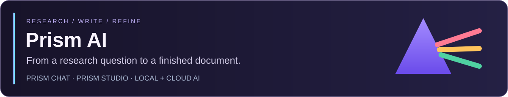

  
  

    <strong>Local-First AI</strong> &nbsp;·&nbsp;
    <strong>Research & Writing Workspaces</strong> &nbsp;·&nbsp;
    <strong>Developer Tooling</strong>
  

  

    <a href="https://dudesquad999.github.io/Prism-Ai/">Live Workspace</a> &nbsp;·&nbsp;
    <a href="#-featured-projects">Featured Projects</a> &nbsp;·&nbsp;
    <a href="https://dev.to/prismaidev">Dev.to</a> &nbsp;·&nbsp;
    <a href="https://www.reddit.com/r/PrismAIApp/">Reddit</a> &nbsp;·&nbsp;
    <a href="https://www.instagram.com/prismhq.ai/">Instagram</a>
  

---

## 👋 Hi, I'm Aidan

I build **local-first, user-controlled software** for research, technical writing, verifiable AI workflows, and developer safety. Every public project is standalone and modular—you never need a mandatory cloud account or platform lock-in to use any of them.

### 🧭 Quick Start — Pick a Tool

| Goal | Project | Stack | Jump In |
| :--- | :--- | :--- | :--- |
| **Research, take notes & compile LaTeX with AI** | [**Prism AI**](https://github.com/DudeSquad999/Prism-Ai) | JS · LaTeX · Ollama | [Try Browser Workspace](https://dudesquad999.github.io/Prism-Ai/) · [Windows Releases](https://github.com/DudeSquad999/Prism-Ai/releases) |
| **Verify LLM outputs & fine-tune LoRA locally** | [**Prism Zero**](https://github.com/DudeSquad999/prism-zero) | Python · PyTorch · PEFT | [Quickstart](https://github.com/DudeSquad999/prism-zero#quick-start) · [Validation Notes](https://github.com/DudeSquad999/prism-zero/blob/main/VALIDATION.md) |
| **Preview & recover lost local Git commits** | [**git-panic**](https://github.com/DudeSquad999/git-panic) | Rust · Git Reflog | [Installation](https://github.com/DudeSquad999/git-panic#installation) · [Usage Guide](https://github.com/DudeSquad999/git-panic/blob/main/docs/guide.md) |

---

## 🚀 Featured Projects

### 🔮 [Prism AI](https://github.com/DudeSquad999/Prism-Ai)

A modular research and writing workspace unifying project notes, source materials, and LaTeX authoring in one place.

* **Prism Chat:** Organize multi-turn research threads, references, and Markdown notes inside dedicated projects.
* **Prism Studio:** Write papers and presentations with LaTeX, BibTeX citations, and automated Tectonic PDF compilation.
* **Bring Your Own Model:** Run offline via local **Ollama** or configure your own cloud API keys independently for Chat and Studio.

**Links:** [Repository](https://github.com/DudeSquad999/Prism-Ai) · [Live Browser Workspace](https://dudesquad999.github.io/Prism-Ai/) · [Windows Releases](https://github.com/DudeSquad999/Prism-Ai/releases) · [Install Guide](https://github.com/DudeSquad999/Prism-Ai/blob/Main/docs/installation.md)

---

### ⚡ [Prism Zero](https://github.com/DudeSquad999/prism-zero)

An offline-first Python toolkit for **generate → verify → curate → fine-tune** local AI pipelines—no hosted API required.

1. **Generate:** Produce candidate outputs from a local checkpoint or scripted baseline.
2. **Verify:** Check outputs against hard constraints (JSON Schema validation, exact rational math, symbolic rules).
3. **Curate:** Retry rejected candidates within a strict budget and save only verified examples.
4. **Fine-Tune:** Inspect the curated dataset and run explicit local LoRA supervised fine-tuning.

**Links:** [Repository](https://github.com/DudeSquad999/prism-zero) · [Quickstart](https://github.com/DudeSquad999/prism-zero#quick-start) · [Source](https://github.com/DudeSquad999/prism-zero/tree/main/prism_zero) · [Validation Notes](https://github.com/DudeSquad999/prism-zero/blob/main/VALIDATION.md)

---

### 🚨 [git-panic](https://github.com/DudeSquad999/git-panic)

> *Find an earlier commit. Give it a branch. Decide what happens next.*

Built while developing Prism AI to make local Git recovery fast, inspectable, and non-destructive. Written in **Rust**.

* **Search Reflog:** Locate earlier or detached commits across your local `HEAD` reflog.
* **Dry-Run Preview:** Inspect target commit metadata and proposed branch names before writing to disk.
* **Safe Branching:** Preserve commits onto a new recovery branch without switching branches or touching working files.

**Links:** [Repository](https://github.com/DudeSquad999/git-panic) · [Installation](https://github.com/DudeSquad999/git-panic#installation) · [Beginner & AI Guide](https://github.com/DudeSquad999/git-panic/blob/main/docs/guide.md)

---

## 🛠️ In Active Development (Private)

* **FolderPilot** *(Python · Windows)* — Review-first desktop file organizer that scans a single directory without recursion, previews destination mappings before moving files, logs local history, and supports checked undo.
* **Prism Web** *(Python · SQLite)* — Full-stack web application prototype exploring Auth0 authentication, Stripe billing workflows, and server-side AI orchestration.

---

## 🧰 Tech Stack & Credentials

* **Languages & Frameworks:** Python (PyTorch, FastAPI, Pydantic), Rust, JavaScript, HTML/CSS, LaTeX / BibTeX
* **Local AI & Tooling:** Ollama, Hugging Face PEFT / LoRA, Tectonic, Git, Windows PowerShell
* **Certification:** [AI Essentials 2026 Certificate of Completion](https://github.com/DudeSquad999/DudeSquad999/blob/main/ai-essentials-2026-certificate.pdf)

---

## 🤝 Connect & Contribute

Issues, reproducible bug reports, and focused pull requests are welcome across all public repositories:

* **Issue Trackers:** [Prism AI](https://github.com/DudeSquad999/Prism-Ai/issues) · [Prism Zero](https://github.com/DudeSquad999/prism-zero/issues) · [git-panic](https://github.com/DudeSquad999/git-panic/issues)
* **Community & Writing:** [Dev.to (@prismaidev)](https://dev.to/prismaidev) · [Reddit (r/PrismAIApp)](https://www.reddit.com/r/PrismAIApp/) · [Instagram (@prismhq.ai)](https://www.instagram.com/prismhq.ai/)

📋 Usage & Scope Notes

 

• All public tools are early-stage software—review AI-generated citations, verification rules, and release notes before production use. 
• The Prism AI public repo hosts the browser workspace and docs; connecting a cloud API key sends included prompts to that provider. 
• <code>git-panic</code> recovers commits recorded in local Git history/reflog; untracked or never-committed edits cannot be recovered. 
• Project cards above are illustrative artwork rather than live UI screenshots.

