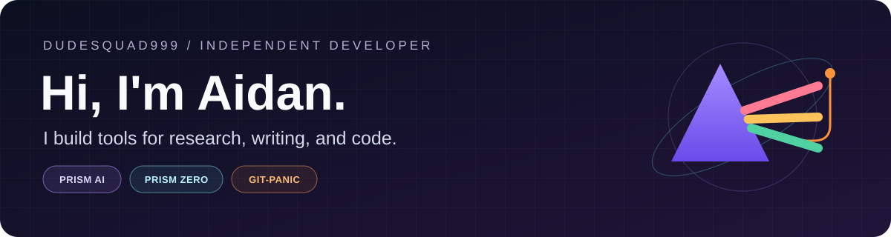
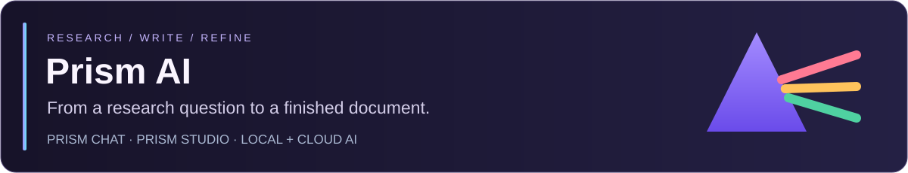
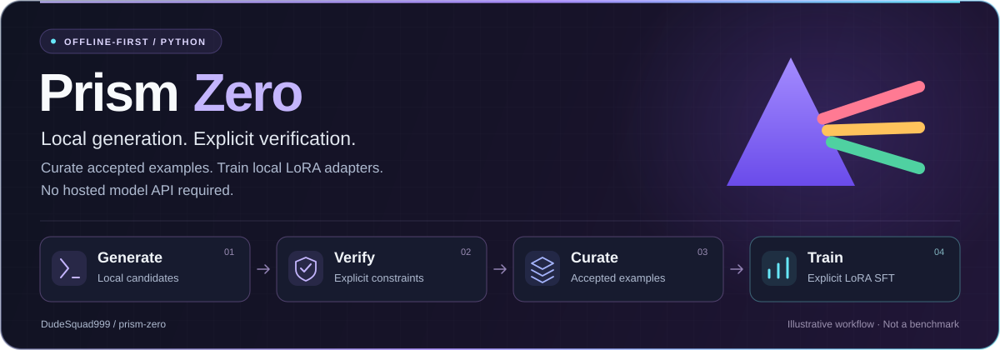
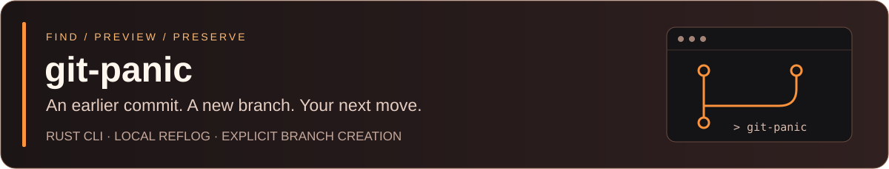

  
  
<strong>Research & Writing</strong> · <strong>Local AI Experiments</strong> · <strong>Developer Tooling</strong>

  

    <a href="#find-your-project">Explore Projects</a> &nbsp;·&nbsp;
    <a href="https://dev.to/prismaidev">Development Notes</a> &nbsp;·&nbsp;
    <a href="#connect-and-contribute">Connect</a>
  

---

## 👋 Hi, I'm Aidan

I'm the developer behind **Prism AI**, **Prism Zero**, **git-panic**, and a separate private **Prism** web-app prototype. I build focused tools for research and writing, local AI experimentation, safer Git recovery, and practical web application engineering.

Each project targets a specific workflow. The public projects are independent; the private Prism prototype is a separate web application.

## 🧭 Find Your Project

| I want to… | Start here | First step |
| :--- | :--- | :--- |
| **Organize research & write with AI** | [Prism AI](https://github.com/DudeSquad999/Prism-Ai) | [Explore the browser workspace](https://dudesquad999.github.io/Prism-Ai/) or [see Windows releases](https://github.com/DudeSquad999/Prism-Ai/releases) |
| **Verify model outputs & train locally** | [Prism Zero](https://github.com/DudeSquad999/prism-zero) | [Run the scripted quickstart](https://github.com/DudeSquad999/prism-zero#quick-start) |
| **Safely preview & recover Git commits** | [git-panic](https://github.com/DudeSquad999/git-panic) | [Read the installation guide](https://github.com/DudeSquad999/git-panic#installation) |

---

## 🔮 Prism AI

A modular research and writing workspace designed to bring questions, source materials, notes, and LaTeX drafts together into a single unified environment.

* **Prism Chat:** Organize deep conversations, sources, and Markdown notes cleanly into distinct projects.
* **Prism Studio:** Author research papers and presentations with built-in LaTeX, BibTeX reference management, and automated PDF compilation via Tectonic.
* **Flexible Models:** Connect local Ollama instances for offline inference or configure your own cloud-provider API keys. Chat and Studio feature independent configuration settings.

[Repository](https://github.com/DudeSquad999/Prism-Ai) · [Windows Releases](https://github.com/DudeSquad999/Prism-Ai/releases) · [Installation Guide](https://github.com/DudeSquad999/Prism-Ai/blob/Main/docs/installation.md) · [Browser Workspace](https://dudesquad999.github.io/Prism-Ai/)

<b>⚠️ Before you try Prism AI</b>

Prism AI is early-stage software. Always review important AI-generated claims and citations manually. The browser workspace can connect to local Ollama for live chat; without Ollama, Chat falls back to labeled sample responses. It does not replace the standalone Windows apps or include live web search, automated citation verification, or heavy document uploads.

The public repository contains the browser workspace and project documentation, not the full source code for the packaged Windows applications. Cloud requests send included content to your configured provider; local inference does not guarantee that every feature functions fully offline.

---

## ⚡ Prism Zero

An offline-first Python toolkit built for exploring deliberate, verifiable local AI workflows:

1. **Generate** a candidate output using a scripted demo or trusted local model checkpoint.
2. **Verify** outputs against explicit hard constraints, such as JSON Schema validation or exact rational arithmetic.
3. **Curate** accepted examples and retry rejected candidates within a controlled execution budget.
4. **Fine-tune** locally by reviewing the compiled dataset and explicitly running local LoRA supervised fine-tuning.

No hosted model API is required. Model weights and optional ML dependencies are kept completely separate.

[Repository](https://github.com/DudeSquad999/prism-zero) · [Quickstart](https://github.com/DudeSquad999/prism-zero#quick-start) · [Source Code](https://github.com/DudeSquad999/prism-zero/tree/main/prism_zero) · [Validation Notes](https://github.com/DudeSquad999/prism-zero/blob/main/VALIDATION.md)

*Passing a configured verification check is not a universal proof of general correctness. Retrying a prompt does not update model weights, and a successful training run does not automatically guarantee improved output quality.*

---

## 🚨 git-panic

Find an earlier commit. Give it a branch. Decide what happens next.

I built `git-panic` out of a practical need for safer, friction-free local Git recovery while developing Prism AI. It is a lightweight local recovery CLI written in Rust.

* **Browse & Search:** Locate lost or earlier commits instantly by inspecting or searching the local HEAD reflog.
* **Preview First:** Inspect the target commit and proposed branch name safely before writing anything to disk.
* **Explicit Branching:** Instantly create a new recovery branch without switching your active branch or altering working files.

[Repository](https://github.com/DudeSquad999/git-panic) · [Installation](https://github.com/DudeSquad999/git-panic#installation) · [Beginner & AI Guide](https://github.com/DudeSquad999/git-panic/blob/main/docs/guide.md)

*Note: This is not an automatic global undo button. A recovery branch preserves an accessible commit, not uncommitted working edits or untracked files.*

---

## 🔐 Private Project

**Prism** is a separate private web-application prototype with a Python/SQLite backend and optional Auth0, Stripe test-mode, and server-side AI integrations. It is not the same product or repository as the public Prism AI research workspace. Its README documents setup requirements, implemented safeguards, and launch blockers. Because the repository is private, there is no public source or demo link.

---

## 📂 All Public Repositories

| Repository | Purpose |
| :--- | :--- |
| [Prism-Ai](https://github.com/DudeSquad999/Prism-Ai) | Research & writing workspace, browser application, and project docs. |
| [prism-zero](https://github.com/DudeSquad999/prism-zero) | Candidate verification, accepted-example curation, and local LoRA training. |
| [git-panic](https://github.com/DudeSquad999/git-panic) | Local Git commit discovery and preview-first branch preservation. |
| [DudeSquad999](https://github.com/DudeSquad999/DudeSquad999) | Profile README, SVG assets, and configuration resources. |

[📦 Browse all repositories on GitHub](https://github.com/DudeSquad999?tab=repositories)

---

## 🎯 What Drives My Work

I care deeply about clean interfaces, high-utility local AI utilities, explicit user control, and comprehensive documentation that removes friction for developers. Each of these projects is entirely modular: **you do not need Prism AI to use Prism Zero or git-panic.**

## 📜 Certifications & Learning

* [AI Essentials 2026 Certificate of Completion](https://github.com/DudeSquad999/DudeSquad999/blob/main/ai-essentials-2026-certificate.pdf)

---

## 🤝 Connect & Contribute

Bug reports, reproducible edge cases, clear documentation feedback, and focused contributions are always welcome. Please review each project's contribution guidelines before opening a pull request.

[Prism AI Issues](https://github.com/DudeSquad999/Prism-Ai/issues) · [Prism Zero Issues](https://github.com/DudeSquad999/prism-zero/issues) · [git-panic Issues](https://github.com/DudeSquad999/git-panic/issues)

[Dev.to Articles](https://dev.to/prismaidev) · [Instagram](https://www.instagram.com/prismhq.ai/) · [Reddit Community](https://www.reddit.com/r/PrismAIApp/)

*Please keep sensitive API keys, passwords, private research, and personal information out of public issues. Use individual security policies for reporting potential vulnerabilities.*

<b>🔒 Privacy & Project Limitations</b>

* Always check each repository's current documentation, test suites, and release notes before relying on a feature in production. This profile serves as a high-level overview, not a formal validation report.
* Utilizing local tools through a cloud-backed assistant does not make your external session offline; always review data transmission policies.
* Git edits that were never stored in local history, expired reflogs, and pruned objects may remain unrecoverable.
* Prism Zero verifiers validate against specific configured constraints only—they are not a secure sandbox or a proof of general reasoning.
* Project cards are illustrative design artwork, not live UI screenshots or benchmark performance charts.

