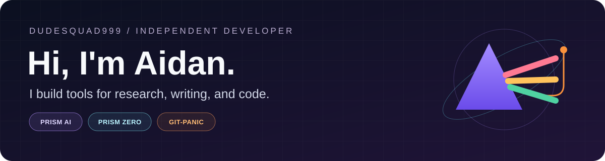
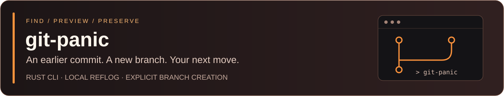

  

  

    Local-First AI &nbsp;·&nbsp;
    Research & Writing Workspaces &nbsp;·&nbsp;
    Developer Tooling
  

  

    Software that helps you think clearly, work locally, and stay in control.
  

  

    <a href="https://dudesquad999.github.io/Prism-Ai/">Live Workspace</a> &nbsp;·&nbsp;
    <a href="#featured-projects">Featured Projects</a> &nbsp;·&nbsp;
    <a href="https://dev.to/prismaidev">Dev.to</a> &nbsp;·&nbsp;
    <a href="https://www.reddit.com/r/PrismAIApp/">Reddit</a> &nbsp;·&nbsp;
    <a href="https://www.instagram.com/prismhq.ai/">Instagram</a>
  

---

## Hi, I'm Aidan

I build practical software for research, technical writing, local AI, and developer workflows.

My projects connect the things I care about most: keeping users in control of their data, making complex tools easier to use, and showing what software is doing before it changes something important.

That means bringing research and LaTeX writing into one workspace, checking generated outputs against explicit rules, and helping developers recover Git commits without disturbing their current work.

I work across Python, Rust, and JavaScript, with a focus on local-first workflows, modular tools, and clear documentation.

### Quick Start: Pick a Tool

| What do you want to do? | Project | Core Technologies | Get Started |
| :--- | :--- | :--- | :--- |
| Research, organize notes, and write LaTeX with AI assistance | [Prism AI](https://github.com/DudeSquad999/Prism-Ai) | JavaScript · LaTeX · Ollama | [Browser Workspace](https://dudesquad999.github.io/Prism-Ai/) · [Windows Releases](https://github.com/DudeSquad999/Prism-Ai/releases) |
| Generate local AI outputs, verify constraints, and curate training data | [Prism Zero](https://github.com/DudeSquad999/prism-zero) | Python · PyTorch · PEFT | [Quickstart](https://github.com/DudeSquad999/prism-zero#quick-start) · [Validation Notes](https://github.com/DudeSquad999/prism-zero/blob/main/VALIDATION.md) |
| Find earlier Git commits and preview a recovery branch | [git-panic](https://github.com/DudeSquad999/git-panic) | Rust · Git Reflog | [Installation](https://github.com/DudeSquad999/git-panic#installation) · [Usage Guide](https://github.com/DudeSquad999/git-panic/blob/main/docs/guide.md) |

---

## Featured Projects

### [Prism AI](https://github.com/DudeSquad999/Prism-Ai)
#### Keep your research connected to your writing.

A modular research and writing workspace that brings project notes, source materials, AI conversations, and LaTeX authoring into one place.

- Prism Chat: Organize multi-turn research threads, references, and Markdown notes within dedicated projects.
- Prism Studio: Write papers and presentations with LaTeX, BibTeX citations, and automated Tectonic PDF compilation.
- Model choice: Use local Ollama models or configure optional cloud providers independently for Chat and Studio.

What I focused on: connecting research organization, model integration, and document production without hiding the differences between local and cloud-backed features.

JavaScript · LaTeX / BibTeX · Ollama · Tectonic

[Repository](https://github.com/DudeSquad999/Prism-Ai) · [Live Browser Workspace](https://dudesquad999.github.io/Prism-Ai/) · [Windows Releases](https://github.com/DudeSquad999/Prism-Ai/releases)

Browser and desktop scope

The public repository hosts the browser workspace and documentation. It does not contain the complete source for the packaged Windows applications. Available features and setup requirements differ between browser and desktop environments.

---

### [Prism Zero](https://github.com/DudeSquad999/prism-zero)
#### Generate locally. Verify explicitly. Train deliberately.

An offline-first Python toolkit for building local AI pipelines where generated outputs must pass defined checks before becoming training examples.

1. Generate: Produce candidates from a local checkpoint or scripted baseline.
2. Verify: Check supported constraints, including JSON Schema validation, exact rational math, and symbolic rules.
3. Curate: Retry rejected candidates within a defined budget and save passing examples.
4. Fine-tune: Inspect the curated dataset and explicitly run local LoRA supervised fine-tuning.

What I focused on: separating model generation from acceptance criteria, bounding retries, and making the path from candidate output to training example inspectable.

Python · PyTorch · Pydantic · JSON Schema · PEFT / LoRA

[Repository](https://github.com/DudeSquad999/prism-zero) · [Quickstart](https://github.com/DudeSquad999/prism-zero#quick-start) · [Source](https://github.com/DudeSquad999/prism-zero/tree/main/prism_zero) · [Validation Notes](https://github.com/DudeSquad999/prism-zero/blob/main/VALIDATION.md)

What verification means

Passing a verifier means an output satisfies the implemented checks. It does not establish general factual correctness, completeness, or suitability for every use case.

---

### [git-panic](https://github.com/DudeSquad999/git-panic)
#### Find an earlier commit. Give it a branch. Decide what happens next.

A focused Rust CLI I built while developing Prism AI to make local Git recovery easier to inspect before changing repository state.

- Search the reflog: Locate earlier or detached commits recorded in your local `HEAD` reflog.
- Preview recovery: Inspect target commit metadata and proposed branch names before creating a branch.
- Preserve the commit: Create a recovery branch without switching branches or modifying working files.

What I focused on: a small, understandable recovery workflow that separates inspection from action and keeps changes narrowly scoped.

Rust · Git Reflog · CLI Tooling

[Repository](https://github.com/DudeSquad999/git-panic) · [Installation](https://github.com/DudeSquad999/git-panic#installation) · [Beginner & AI Guide](https://github.com/DudeSquad999/git-panic/blob/main/docs/guide.md)

Recovery limits

Recovery depends on the relevant commits still being available locally. Untracked files and edits that were never committed cannot be recovered by this tool.

---

## What Connects My Projects

Different tools, consistent priorities:

- User control: Make local processing and optional external services easy to distinguish.
- Inspectable workflows: Show proposed actions and acceptance criteria rather than hiding them.
- Deliberate changes: Preview recovery actions, bound retries, and require explicit training steps.
- Practical delivery: Treat setup instructions, usage guides, and limitations as part of the product.

---

## In Active Development

These projects are currently private and are included as development context, not public code samples.

- FolderPilot | Python · Windows  
  A review-first desktop file organizer. Scans one directory without recursion, previews destination mappings before moving files, records local history, and supports checked undo.

- Prism Web | Python · SQLite  
  A full-stack web application prototype exploring Auth0 authentication, Stripe billing workflows, and server-side AI orchestration.

---

## Tech Stack & Credentials

| Area | Technologies |
| :--- | :--- |
| Languages | Python, Rust, JavaScript, HTML/CSS, PowerShell |
| APIs & Validation | FastAPI, Pydantic, JSON Schema |
| Local AI & Training | Ollama, PyTorch, Hugging Face PEFT, LoRA |
| Data | SQLite, JSONL datasets |
| Research & Writing | Markdown, LaTeX, BibTeX, Tectonic |
| Developer Tooling | Git, CLI development, Windows packaging |

[AI Essentials 2026 Certificate of Completion](https://github.com/DudeSquad999/DudeSquad999/blob/main/ai-essentials-2026-certificate.pdf)

---

## Connect & Contribute

Want to understand how I build? Start with a featured project, explore its available source, and read the documentation for the decisions and limitations behind it.

I share development notes and project updates on [Dev.to](https://dev.to/prismaidev), [Reddit](https://www.reddit.com/r/PrismAIApp/), and [Instagram](https://www.instagram.com/prismhq.ai/).

Reproducible bug reports, documentation improvements, and focused pull requests are welcome:

[Prism AI Issues](https://github.com/DudeSquad999/Prism-Ai/issues) ·
