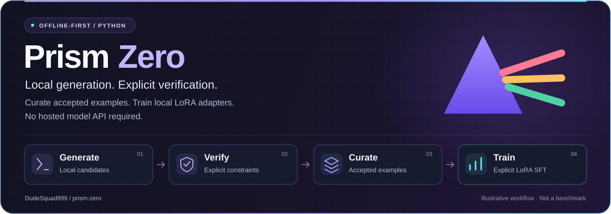

  

  <h3>I build tools that help people research, create, and protect their work.</h3>

  

    Local-first AI · Research and writing software · Developer tools
  

  

    <a href="#featured-projects">Explore My Projects</a> &nbsp;·&nbsp;
    <a href="https://dudesquad999.github.io/Prism-Ai/">Try Prism AI</a> &nbsp;·&nbsp;
    <a href="https://dev.to/prismaidev">Read My Build Notes</a> &nbsp;·&nbsp;
    <a href="https://github.com/DudeSquad999?tab=repositories">Browse My Code</a>
  

## Hi, I'm Aidan

I'm a developer working with Python, Rust, and JavaScript to build practical tools for research, local AI, and everyday development.

My projects start with problems I want to solve: keeping research connected to writing, checking AI outputs before using them, and recovering Git commits without disturbing current work.

I care about what happens beyond the first successful demo. That includes clear setup instructions, understandable limitations, and workflows that let people inspect a result before accepting a change.

## Start Here

| Project | What I built | Explore |
| :--- | :--- | :--- |
| [Prism AI](https://github.com/DudeSquad999/Prism-Ai) | A research and writing workspace connecting notes, AI conversations, and LaTeX authoring. | [Browser workspace](https://dudesquad999.github.io/Prism-Ai/) · [Windows releases](https://github.com/DudeSquad999/Prism-Ai/releases) |
| [Prism Zero](https://github.com/DudeSquad999/prism-zero) | A local AI pipeline for generating candidates, checking constraints, and curating training examples. | [Quickstart](https://github.com/DudeSquad999/prism-zero#quick-start) · [Validation notes](https://github.com/DudeSquad999/prism-zero/blob/main/VALIDATION.md) |
| [git-panic](https://github.com/DudeSquad999/git-panic) | A Rust CLI for finding local Git commits and preserving them on recovery branches. | [Installation](https://github.com/DudeSquad999/git-panic#installation) · [Usage guide](https://github.com/DudeSquad999/git-panic/blob/main/docs/guide.md) |

## Featured Projects

### Prism AI
#### Keep research and writing in the same workflow.

Prism AI brings project notes, source materials, AI conversations, and technical writing into a connected workspace.

- Prism Chat organizes research conversations, references, and Markdown notes within projects.
- Prism Studio supports LaTeX authoring, BibTeX citations, and PDF compilation through Tectonic.
- Model configuration supports local Ollama workflows and optional cloud providers, with independent settings for Chat and Studio.

The engineering challenge is connecting these activities without hiding their different requirements. Research organization, model integration, and document compilation each need clear configuration and useful feedback.

JavaScript · LaTeX · BibTeX · Ollama · Tectonic

[Try the browser workspace](https://dudesquad999.github.io/Prism-Ai/) · [Explore the repository](https://github.com/DudeSquad999/Prism-Ai) · [View Windows releases](https://github.com/DudeSquad999/Prism-Ai/releases)

Source availability and capabilities

The public repository contains the browser workspace and documentation, not the complete source for the packaged Windows applications. Browser and desktop capabilities differ. Local inference and document compilation depend on the relevant environment and setup.

### Prism Zero
#### Generate locally. Check explicitly. Train deliberately.

A generated answer is a candidate, not a guarantee. Prism Zero separates producing an output from deciding whether it meets defined requirements.

Its local workflow has four stages:

1. Generate candidates from a local checkpoint or scripted baseline.
2. Check supported constraints, including JSON Schema, exact rational math, and symbolic rules.
3. Save passing examples and retry rejected candidates within a defined budget.
4. Inspect the curated dataset before explicitly running local LoRA supervised fine-tuning.

My focus here is making acceptance criteria inspectable and keeping generation, verification, and training separate.

Python · PyTorch · Pydantic · JSON Schema · PEFT / LoRA

[Run the quickstart](https://github.com/DudeSquad999/prism-zero#quick-start) · [Inspect the source](https://github.com/DudeSquad999/prism-zero/tree/main/prism_zero) · [Read the validation notes](https://github.com/DudeSquad999/prism-zero/blob/main/VALIDATION.md)

What verification establishes

An accepted output has passed the implemented checks. That does not establish general factual correctness, completeness, or suitability for every use case.

### git-panic
#### Find the commit. Preview the recovery. Keep control.

I built git-panic while developing Prism AI to make local Git recovery easier to inspect before taking action.

The Rust CLI keeps the process focused:

1. Search the local `HEAD` reflog for earlier or detached commits.
2. Preview commit metadata and the proposed recovery branch name.
3. Preserve the selected commit on a new branch without switching branches or modifying working files.

The design priority is a narrow, understandable recovery action. Inspect first, create a recovery branch second, and leave the current working files alone.

Rust · Git reflog · CLI tooling

[Install git-panic](https://github.com/DudeSquad999/git-panic#installation) · [Explore the code](https://github.com/DudeSquad999/git-panic) · [Read the guide](https://github.com/DudeSquad999/git-panic/blob/main/docs/guide.md)

Recovery limits

Recovery depends on the relevant commits still being available in the local repository. git-panic cannot restore untracked files or edits that were never committed.

## How I Build

| Principle | Where it shows up |
| :--- | :--- |
| Preview before changing | Recovery previews in git-panic and proposed file moves in FolderPilot |
| Define what passes | Explicit constraints and bounded retries in Prism Zero |
| Explain processing boundaries | Distinguishing local inference from optional cloud services |
| Follow the complete workflow | Connecting research to documents and generated candidates to curated datasets |
| Document the limits | Clear notes about verification, recovery, and source availability |

## Technical Toolkit

| Area | Technologies |
| :--- | :--- |
| Languages | Python, Rust, JavaScript, HTML/CSS, PowerShell |
| AI and model workflows | Ollama, PyTorch, Hugging Face PEFT, LoRA |
| APIs and validation | FastAPI, Pydantic, JSON Schema |
| Data | SQLite, JSONL datasets |
| Research and documents | Markdown, LaTeX, BibTeX, Tectonic |
| Development | Git, CLI tooling, Windows packaging |

## Currently Building

These projects are private and are included as development context, not public code samples.

### FolderPilot

A review-first Windows file organizer built with Python. It scans a single directory without recursion, previews proposed moves, records local history, and supports checked undo.

The goal is to make file organization easier without making file operations invisible.

### Prism Web

A Python and SQLite web application prototype exploring Auth0 authentication, Stripe billing workflows, and server-side AI orchestration.

The focus is understanding how identity, application state, and external services fit into a complete web application.

## Learning and Credentials

[AI Essentials 2026 Certificate of Completion](https://github.com/DudeSquad999/DudeSquad999/blob/main/ai-essentials-2026-certificate.pdf)

## Connect and Contribute

Interested in how I work? Start with a featured repository and explore its implementation, documentation, and release notes.

I share development notes and project updates here:

[Dev.to](https://dev.to/prismaidev) · [Reddit](https://www.reddit.com/r/PrismAIApp/) · [Instagram](https://www.instagram.com/prismhq.ai/)

Reproducible bug reports, documentation improvements, and focused pull requests are welcome.

[Prism AI issues](https://github.com/DudeSquad999/Prism-Ai/issues) · [Prism Zero issues](https://github.com/DudeSquad999/prism-zero/issues) · [git-panic issues](https://github.com/DudeSquad999/git-panic/issues)

Usage notes

- These projects are early-stage software. Review requirements, limitations, and release notes before relying on them for important work.
- Cloud-backed features send submitted content to the selected provider.
- AI-generated statements and citations require review. Automated verification covers only the implemented checks.
- Public repositories and packaged applications may differ in source availability and capabilities.
- Project cards are illustrative artwork, not live application screenshots.

